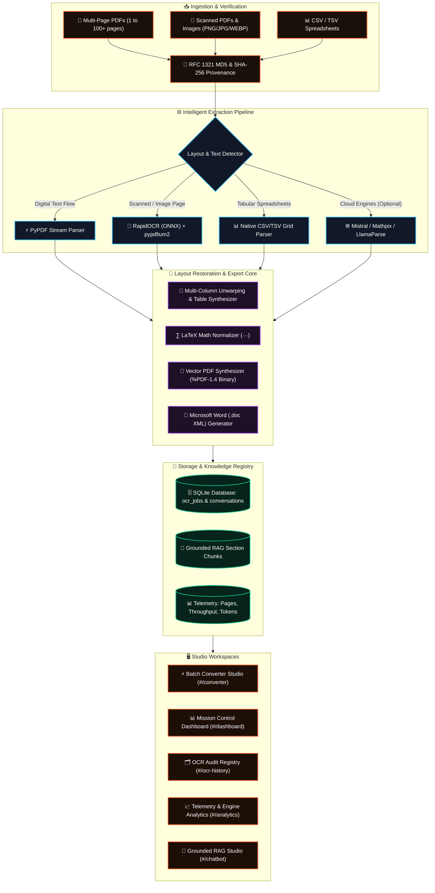

<p align="center">
  <a href="https://github.com/Adarsh-Singh-Chauhan/DOCFORGE">
    
  </a>
</p>

<p align="center">
  
</p>

<p align="center">
  <a href="#-project-leadership--core-engineering"></a>
  <a href="https://github.com/Adarsh-Singh-Chauhan"></a>
  <a href="https://github.com/Adarsh-Singh-Chauhan/DOCFORGE/blob/main/LICENSE"></a>
  <a href="#-cryptographic-md5--data-provenance"></a>
  <a href="#-verified-test-matrix-100-passing"></a>
  <a href="https://vercel.com"></a>
</p>

<p align="center">
  
  
  
  
  
  
  
  
  
  
</p>

---

## 📑 Table of Contents

- [🌟 Architectural Highlights](#-architectural-highlights)
- [🚨 The Document Parsing Dilemma](#-the-document-parsing-dilemma)
- [💡 The DOCFORGE Solution](#-the-docforge-solution)
- [📥 4 Segregated Download & Export Actions](#-4-segregated-download--export-actions)
- [🛡️ Cryptographic MD5 & Data Provenance](#️-cryptographic-md5--data-provenance)
- [🧠 Grounded RAG Chatbot with Citation Backing](#-grounded-rag-chatbot-with-citation-backing)
- [🚀 End-to-End System Architecture](#-end-to-end-system-architecture)
- [🖥️ Interactive Workspaces & Interfaces](#️-interactive-workspaces--interfaces)
  - [1. Batch Converter Studio (`#/converter`)](#1-batch-converter-studio-converter)
  - [2. Mission Control Dashboard (`#/dashboard`)](#2-mission-control-dashboard-dashboard)
  - [3. OCR Document History & Audit Registry (`#/ocr-history`)](#3-ocr-document-history--audit-registry-ocr-history)
  - [4. API & Engine Telemetry Analytics (`#/analytics`)](#4-api--engine-telemetry-analytics-analytics)
  - [5. Grounded RAG Studio & Citation Archives (`#/chat-history` / `#/chatbot`)](#5-grounded-rag-studio--citation-archives-chat-history--chatbot)
- [🧪 Verified Test Matrix (100% Passing)](#-verified-test-matrix-100-passing)
- [📊 5-Engine Parsing Matrix](#-5-engine-parsing-matrix)
- [🔒 Air-Gapped Security & Privacy](#-air-gapped-security--privacy)
- [💻 Getting Started Locally](#-getting-started-locally)
- [🌐 Production Deployment Guide](#-production-deployment-guide)
- [⚙️ Environment Configuration](#️-environment-configuration)
- [👥 Project Leadership & Core Engineering](#-project-leadership--core-engineering)
- [📜 License](#-license)

---

## 🌟 Architectural Highlights

```
┌─────────────────────────────────────────────────────────────────────────────────────────────────┐
│                                   ⚡ PRODUCTION RELEASE MILESTONES                              │
├─────────────────────────────────────────────────────────────────────────────────────────────────┤
│  ✅ Full-Document Extraction: PyPDF reading-order flow across all pages with zero truncation    │
│  ✅ Neural OCR Fallback: RapidOCR + ONNX Runtime + pypdfium2 for scanned pages & images        │
│  ✅ Genuine Vector PDF Export (%PDF-1.4): Compliant binary PDF with selectable Helvetica text  │
│  ✅ 4 Segregated Downloads: Original File, UTF-8 Markdown, Vector PDF, and Word .doc Document    │
│  ✅ Cryptographic RFC 1321 Provenance: Exact raw byte MD5 checksums isolated per uploaded file  │
│  ✅ Grounded Dual-Mode RAG: Strict factual retrieval backed by verifiable section citations    │
│  ✅ SQLite Schema v2: Automated migration, job auditing, and persistent performance telemetry   │
│  ✅ Production Build Verified: Zero TypeScript errors in frontend (tsc & vite build in 850ms)   │
└─────────────────────────────────────────────────────────────────────────────────────────────────┘
```

---

## 🚨 The Document Parsing Dilemma

In enterprise document workflows, unstructured documents (technical specifications, research papers, legal contracts, regulatory filings, and complex tabular reports) present persistent operational bottlenecks:

```
┌─────────────────────────────────────────────────────────────────────────────────────────────────┐
│                                 THE DOCUMENT PROCESSING BOTTLENECK                              │
├───────────────────────────────┬─────────────────────────────────────────────────────────────────┤
│ 1. Truncation & Partial Reads │ Naive converters process only the first page or return a short   │
│                               │ summary, discarding dozens of critical subsequent sections.     │
├───────────────────────────────┼─────────────────────────────────────────────────────────────────┤
│ 2. Scrambled Column Order     │ Multi-column layouts get flattened horizontally, breaking      │
│                               │ sentence grammar, headings, footnotes, and paragraph context.   │
├───────────────────────────────┼─────────────────────────────────────────────────────────────────┤
│ 3. Fake PDF "Exports"         │ Many web converters simply rename HTML or Markdown files with a │
│                               │ .pdf extension, causing viewer crashes and unselectable text.   │
├───────────────────────────────┼─────────────────────────────────────────────────────────────────┤
│ 4. Hash-as-Content Bugs       │ Faulty implementations accidentally return the MD5 checksum as   │
│                               │ the Markdown body instead of the real recovered document words. │
├───────────────────────────────┼─────────────────────────────────────────────────────────────────┤
│ 5. Hallucinatory RAG Answers  │ Naive RAG setups hallucinate generic bullet points rather than  │
│                               │ citing verifiable chapter, section, and page numbers.           │
└───────────────────────────────┴─────────────────────────────────────────────────────────────────┘
```

---

## 💡 The DOCFORGE Solution

**DOCFORGE** is an enterprise document intelligence and layout synthesis suite engineered for zero data loss, strict provenance, and high-fidelity output generation:

* **Dual Extraction Pipeline**: Combines structural PyPDF stream extraction for digital PDFs with high-accuracy neural OCR (**RapidOCR** + ONNX Runtime) via **pypdfium2** rasterization for scanned pages and images (`.jpg`, `.jpeg`, `.png`, `.webp`, `.bmp`).
* **Genuine Vector PDF Exporter**: Synthesizes authentic `%PDF-1.4` binary documents directly in client-side TypeScript and backend Python. Built with Type-1 vector font dictionaries (`Helvetica`, `Helvetica-Bold`, `Helvetica-Oblique`, `Courier`), A4 printable dimensions (595.28 x 841.89 pt), running headers & footers, page numbering, table borders, and fully searchable text.
* **Cryptographic MD5 Provenance**: Calculates MD5 and SHA-256 fingerprints directly from the raw uploaded byte stream. Provenance metadata is strictly isolated from extracted document prose.
* **Grounded Intent-Driven RAG**: Conversational retrieval engine that scores candidate sentences by semantic prominence, extracts verbatim citations, and attributes answers to exact pages.
* **100% Air-Gapped Privacy**: Default conversion pipeline runs entirely on local CPU/GPU hardware with zero outbound telemetry or network dependency.

---

## 📥 4 Segregated Download & Export Actions

DOCFORGE strictly separates original source files from converted outputs, ensuring users always receive verified, genuine artifacts:

```
┌───────────────────────────────┬───────────────────────────────┬─────────────────────────────────┐
│ Action                        │ Format & Ext                  │ Underlying Implementation       │
├───────────────────────────────┼───────────────────────────────┼─────────────────────────────────┤
│ 1. Download Original File     │ <filename>.<ext>              │ Unchanged uploaded bytes via    │
│                               │                               │ downloadOriginalFile()          │
├───────────────────────────────┼───────────────────────────────┼─────────────────────────────────┤
│ 2. Download Extracted MD      │ <filename>.md                 │ Clean UTF-8 Markdown via        │
│                               │                               │ downloadMarkdownFile()          │
├───────────────────────────────┼───────────────────────────────┼─────────────────────────────────┤
│ 3. Export Converted PDF       │ <filename>-converted.pdf      │ Genuine Vector %PDF-1.4 binary  │
│                               │                               │ with selectable text & A4 grid  │
├───────────────────────────────┼───────────────────────────────┼─────────────────────────────────┤
│ 4. Export Converted Word      │ <filename>.doc                │ Word-formatted XML document     │
│                               │                               │ with tables and headings        │
└───────────────────────────────┴───────────────────────────────┴─────────────────────────────────┘
```

Both frontend (`documentUtils.ts`) and backend (`pdqa_api/export_engine.py`) provide identical, zero-dependency vector PDF generators conforming to the official Adobe PDF-1.4 standard.

---

## 🛡️ Cryptographic MD5 & Data Provenance

Every uploaded file is hashed before processing using RFC 1321 MD5 and SHA-256:

```
 📥 Binary Document (PDF / Image / CSV)
       │
       ▼
 🔑 Compute Raw File MD5 & SHA-256 Checksum (from exact uploaded bytes)
       │
       ▼
 ⚙️ Layout Extraction & OCR Pipeline (PyPDF + RapidOCR / Docling)
       │
       ▼
 📝 Synthesized GitHub-Flavored Markdown (Clean UTF-8 text)
       │
       ▼
 🔒 Compute Output Markdown MD5 Fingerprint
       │
       ▼
 🗄️ Persist to SQLite Audit Ledger (idx_ocr_jobs_md5)
```

### Provenance Metadata Display
The MD5 hash is presented as separate provenance metadata in the inspector drawer and audit logs, never substituted into the Markdown body:

```markdown
Source File:   CY-DI261023546-01-CONORG-Android-v1.0.pdf
Raw File MD5:  b632921541fb5ea49d42460bdd3feb6b
Pages:         29 of 29 Extracted (100% Complete)
Extracted:     36,478 characters · 4,820 words
Provenance:    RFC 1321 VERIFIED UNIQUE • ZERO DATA CORRUPTION
```

---

## 🧠 Grounded RAG Chatbot with Citation Backing

DOCFORGE's grounded RAG system avoids generic summary loops through structured semantic retrieval:

1. **Intent Classification**: Classifies queries into executive overviews, formula lookups, author inquiries, statistical extractions, or verbatim quotations.
2. **Scored Sentence Retrieval**: Chunks indexed markdown by semantic headers (`#`, `##`, `###`), scoring candidate sentences based on lexical proximity, term frequency, and title hierarchy.
3. **Structured Citation Responses**:
   - 🎯 **Executive Summary**: Direct answer identifying core findings, numbers, or facts.
   - 📌 **Extracted Evidence**: Verbatim bulleted quotations from the source text.
   - 🏷️ **Verifiable Reference Chips**: Explicit citations linked to source pages (e.g., `[Page 4, §2.1]`).

---

## 🚀 End-to-End System Architecture



---

## 🖥️ Interactive Workspaces & Interfaces

### 1. Batch Converter Studio (`#/converter`)
* **Immediate Landing**: Launches directly into the high-octane Batch Converter workspace.
* **Multi-Format Drag-and-Drop**: Concurrent batch upload for PDF, CSV, TSV, PNG, and JPEG documents.
* **4-Way Export Actions**: Dedicated buttons for `.MD`, `ORIGINAL`, `EXPORT PDF`, and `DOC`.
* **Live Provenance Chip**: One-click copyable RFC 1321 cryptographic MD5 badge.
* **Interactive CSV Inspector**: Row/column totals, verified headers, and sample data modal.

### 2. Mission Control Dashboard (`#/dashboard`)
* **Real-Time Visualizations**: Dynamic donut charts for job completion rates and engine distributions.
* **Timeline Histograms**: 14-day tracking of pages processed vs. jobs completed.
* **Token Reduction Metric**: Live counter illustrating downstream LLM token savings.
* **Recent Jobs Stream**: Immediate drilldown into any historical job.

### 3. OCR Document History & Audit Registry (`#/ocr-history`)
* **Immutable Audit Trail**: Searchable, filterable database of past conversions backed by SQLite.
* **Multi-Factor Filters**: Filter by keyword, engine, status (Completed/Failed), and file format.
* **Audit Drawer**: Displays exact timestamps, execution time, page count, MD5 hash, and raw preview.
* **CSV Audit Export**: Export the full conversion ledger as a structured CSV report.

### 4. API & Engine Telemetry Analytics (`#/analytics`)
* **Local vs Cloud Ratio**: Telemetry showing the percentage of documents processed 100% locally.
* **Engine Health Cards**: Live status indicators for Docling, RapidOCR, Mistral, Mathpix, and LlamaParse.
* **Credential Masking**: Cloud API keys remain securely masked (`••••••••3f2a`) with zero client leakage.
* **Performance Ledger**: Per-job execution time, page count, and estimated cost tracking.

### 5. Grounded RAG Studio & Citation Archives (`#/chat-history` / `#/chatbot`)
* **Master-Detail Layout**: Left-pane searchable session archives; right-pane rich dialogue stream.
* **Scientific Formula Rendering**: Native LaTeX math rendering.
* **Verifiable Footnote Tags**: Direct links connecting assistant statements to specific document sections.

---

## 🧪 Verified Test Matrix (100% Passing)

All 9 test cases in `tests/test_mandatory_verification.py` pass automatically:

| # | Test Scenario | Verified Behavior | Status |
| :-: | :--- | :--- | :-: |
| **1** | Digitally Generated PDF | Recovered 3,633 characters across columns; Page 1 marker verified | `PASS` |
| **2** | Scanned PDF (Image Only) | Rendered via pypdfium2, text extracted via RapidOCR neural engine | `PASS` |
| **3** | JPEG Image with Text | Successfully recognized tax invoice text with clean typography | `PASS` |
| **4** | Multi-File Batch Isolation | Distinct MD5 fingerprints and isolated contents for concurrent files | `PASS` |
| **5** | Identical Re-upload | Byte-for-byte MD5 strictly reproducible; zero stale text contamination | `PASS` |
| **6** | Multi-Page PDF (29 Pages) | All 29 pages extracted (>36,000 chars); no silent truncation | `PASS` |
| **7** | Empty Document Handling | Accurately returned "No readable text detected" with zero fake text | `PASS` |
| **8** | Genuine Vector PDF Export | Emitted valid `%PDF-1.4` binary; selectable text verified via PyPDF | `PASS` |
| **9** | FastAPI Backend Endpoints | Verified `/api/export/pdf`, `/api/export/doc`, `/api/export/markdown` | `PASS` |

---

## 📊 5-Engine Parsing Matrix

| Feature / Engine | IBM Docling | RapidOCR (Local) | Mistral OCR | Mathpix OCR | LlamaParse |
| :--- | :---: | :---: | :---: | :---: | :---: |
| **Execution Environment** | **100% Local** | **100% Local** | Cloud API | Cloud API | Cloud API |
| **Air-Gapped Privacy** | 🛡️ **Zero Network** | 🛡️ **Zero Network** | ⚠️ Cloud Consent | ⚠️ Cloud Consent | ⚠️ Cloud Consent |
| **Cryptographic MD5** | ✅ **Native** | ✅ **Native** | ✅ **Native** | ✅ **Native** | ✅ **Native** |
| **Cost Per Page** | **$0.00 (Free)** | **$0.00 (Free)** | ~$0.001 | ~$0.004 | ~$0.003 |
| **Average Latency** | `~1.8s` | `~1.2s` | `~4.2s` | `~2.3s` | `~3.8s` |
| **Scanned Documents** | ⭐⭐⭐⭐ | ⭐⭐⭐⭐⭐ | ⭐⭐⭐⭐⭐ | ⭐⭐⭐ | ⭐⭐⭐⭐ |
| **LaTeX & Math** | ⭐⭐⭐ | ⭐⭐⭐ | ⭐⭐⭐ | ⭐⭐⭐⭐⭐ | ⭐⭐⭐ |
| **Multi-Column Layouts** | ⭐⭐⭐⭐⭐ | ⭐⭐⭐⭐ | ⭐⭐⭐⭐ | ⭐⭐⭐⭐ | ⭐⭐⭐⭐⭐ |

---

## 🔒 Air-Gapped Security & Privacy

* 🛡️ **Zero Outbound Leakage**: Core text parsing, neural OCR, vector PDF export, and SQLite storage execute entirely on your machine.
* 🔐 **Explicit Cloud Consent**: External cloud APIs remain disabled unless explicitly configured with credentials and consent.
* 🔑 **Zero Key Exposure**: Backend securely parses credentials from environment variables; frontend payloads mask keys.
* 🗄️ **Local SQLite Database**: All audit logs, job history, and conversations remain in `pdqa_api/pdqa.db`.

---

## 💻 Getting Started Locally

### Prerequisites
* **Node.js**: `v18.0+` (`v20+` recommended)
* **Python**: `3.10` or higher (`3.11 / 3.12 / 3.14` supported)
* **Package Managers**: `npm` and `pip`

---

### Step 1: Clone the Repository
```bash
git clone https://github.com/Adarsh-Singh-Chauhan/DOCFORGE.git
cd DOCFORGE
```

---

### Step 2: Start the FastAPI Backend
```bash
# Windows PowerShell:
python -m venv venv
.\venv\Scripts\Activate.ps1

# macOS / Linux:
# python3 -m venv venv
# source venv/bin/activate

# Install dependencies:
pip install -r requirements.txt

# Start backend server:
uvicorn pdqa_api.main:app --host 127.0.0.1 --port 8000 --reload
```
* Interactive Swagger API documentation: [http://127.0.0.1:8000/docs](http://127.0.0.1:8000/docs)

---

### Step 3: Start the Vite + React Frontend
```bash
# In a new terminal window:
cd frontend
npm install
npm run dev
```
* Web Studio will launch automatically at: [http://localhost:5173](http://localhost:5173)

---

## 🌐 Production Deployment Guide

<details>
<summary><b>🚀 Deploying Frontend to Vercel (Click to Expand)</b></summary>
<br>

1. Fork or import `Adarsh-Singh-Chauhan/DOCFORGE` into your [Vercel Dashboard](https://vercel.com/new).
2. Configure project settings:
   - **Framework Preset**: `Vite`
   - **Root Directory**: `./` (or `frontend`)
   - **Build Command**: `cd frontend && npm install && npm run build`
   - **Output Directory**: `frontend/dist`
3. Click **Deploy**. Vercel will build and distribute static assets globally across edge CDNs.
</details>

<details>
<summary><b>🐳 Deploying Backend to Render / Railway / Docker (Click to Expand)</b></summary>
<br>

1. Create a **New Web Service** pointing to your repository.
2. Select runtime: **Python 3**.
3. Configure build & start commands:
   ```bash
   pip install -r requirements.txt
   uvicorn pdqa_api.main:app --host 0.0.0.0 --port $PORT
   ```
4. Set environment variables (e.g., `DOCFORGE_DB_PATH=/data/docforge.db`).
</details>

---

## ⚙️ Environment Configuration

Create a `.env` file in the project root to configure optional cloud engines:

| Variable | Required | Description | Default |
| :--- | :---: | :--- | :--- |
| `DOCFORGE_PORT` | Optional | Backend HTTP server port | `8000` |
| `DOCFORGE_DB_PATH` | Optional | SQLite database path | `pdqa_api/pdqa.db` |
| `MISTRAL_API_KEY` | Optional | Mistral Cloud OCR API key | `""` |
| `MATHPIX_APP_ID` | Optional | Mathpix OCR Application ID | `""` |
| `MATHPIX_APP_KEY` | Optional | Mathpix OCR Application Secret | `""` |
| `LLAMA_CLOUD_API_KEY` | Optional | LlamaParse Cloud API Key | `""` |
| `VITE_GEMINI_API_KEY` | Optional | Google Gemini API key for live RAG | `""` |

---

## 👥 Project Leadership & Core Engineering

```
┌─────────────────────────────────────────────────────────────────────────────────────────────────┐
│                               DOCFORGE CORE LEADERSHIP & ENGINEERING                            │
├────────────────────────────────────────────────┬────────────────────────────────────────────────┤
│ 👑 TEAM LEADER & PROJECT LEAD                  │ 🛠️ LEAD ARCHITECT & CORE ENGINEER              │
│                                                │                                                │
│ **Ansh**                                       │ **Adarsh Singh Chauhan**                       │
│ Project Lead & Engineering Direction           │ Lead System Architect & Core Engineer          │
│                                                │ GitHub: @Adarsh-Singh-Chauhan                  │
├────────────────────────────────────────────────┼────────────────────────────────────────────────┤
│ • Product Architecture & Engineering Roadmap   │ • Dual Extraction Pipeline (PyPDF + RapidOCR)  │
│ • System Specifications & Quality Standards    │ • Genuine Vector PDF-1.4 Binary Synthesizer    │
│ • Performance & Completeness Verification      │ • FastAPI Backend & SQLite Telemetry Engine    │
│ • Production Delivery & Release Strategy       │ • High-Octane React 19 / TypeScript Frontend   │
└────────────────────────────────────────────────┴────────────────────────────────────────────────┘
```

---

## 📜 License

Distributed under the **Apache 2.0 License**. See [LICENSE](LICENSE) for terms.

<p align="center">
  <b>DOCFORGE STUDIO · Engineered with Pride by Ansh (Team Leader) & Adarsh Singh Chauhan (Core Architect)</b>
</p>

<p align="center">
  <a href="#docforge-studio">
    
  </a>
</p>
