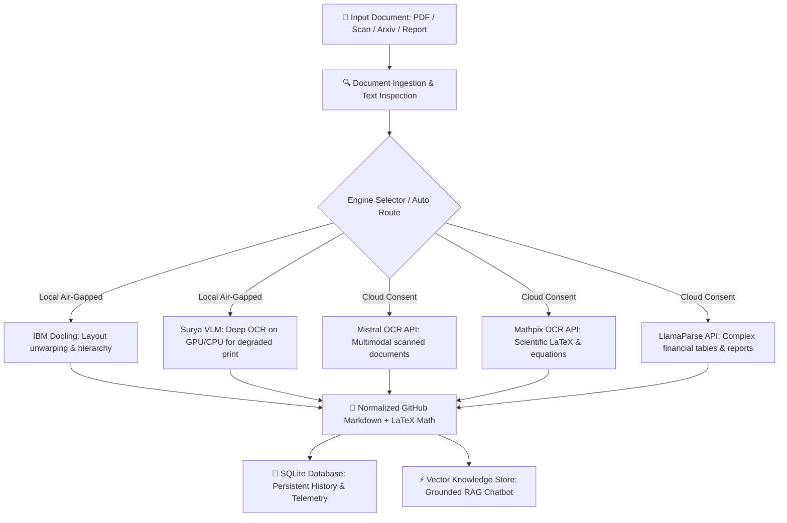

<p align="center">
  <br/>
  <code>// ENTERPRISE DOCUMENT INTELLIGENCE & TELEMETRY PLATFORM</code>
  <br/>
  <h1 align="center" style="font-weight: 900; letter-spacing: -0.04em;">
    DOCFORGE <span style="color: #e04f16;">STUDIO</span>
  </h1>
  <p align="center">
    <strong>Convert any document (PDFs, Scanned Manuscripts, SEC 10-K Reports, Academic Papers) into clean, token-efficient Markdown — powered by 5 selectable AI engines, local vector RAG, complete audit history, and live telemetry analytics.</strong>
  </p>
</p>

<p align="center">
  <a href="#live-deployment"></a>
  <a href="#multi-engine-architecture"></a>
  <a href="#privacy--security"></a>
  <a href="#quickstart"></a>
  <a href="LICENSE"></a>
</p>

---

## ⚡ Key Workspaces & Capabilities

| Workspace | Route | Description |
| :--- | :--- | :--- |
| **Mission Control Dashboard** | `#/dashboard` | Database-backed KPI metrics, daily job throughput histograms, engine latency comparisons, and recent activity streams. |
| **Batch OCR Converter** | `#/converter` | Multi-file parallel processing, 6-engine smart selector, cloud consent authorization, and live Markdown inspector. |
| **OCR Document History** | `#/ocr-history` | Persistent audit registry with search, status/engine filters, sorting, pagination, retry on failure, and CSV/JSON export. |
| **OCR Job Detail Inspector** | `#/ocr-history/:id` | 5-stage pipeline trace (Ingestion → Inspection → OCR → Synthesis → Normalization), metadata HUD, LaTeX math rendering, and `.md` downloads. |
| **RAG Intelligence Studio** | `#/chatbot` | Local semantic search and dialogue with verifiable source citations grounded in your converted documents. |
| **Chat History Archives** | `#/chat-history` | Full dialogue preservation, in-place conversation renaming, deletion, Markdown export, and one-click chat continuation. |
| **API & Engine Analytics** | `#/analytics` | Local air-gapped vs external cloud provider comparison, privacy ratio metrics, latency per page, and estimated costs. |

---

## 🏛️ Multi-Engine Architecture

DOCFORGE unifies the five most powerful document parsing and OCR engines under a single modular interface:



---

## 🌐 Live Deployment (How to make it Live)

### Option A: Deploy Frontend on Vercel (Recommended & 100% Free)

1. Go to [https://vercel.com/new](https://vercel.com/new).
2. Connect your GitHub account and import **`Adarsh-Singh-Chauhan/DOCFORGE`**.
3. Configure the Project Settings:
   - **Framework Preset**: `Vite`
   - **Root Directory**: `./` (or `frontend`)
   - **Build Command**: `cd frontend && npm install && npm run build`
   - **Output Directory**: `frontend/dist`
4. Click **Deploy**. Your DOCFORGE website will be live at `https://docforge-*.vercel.app` in under 60 seconds!

### Option B: Deploy Backend API on Render or Railway

1. Go to [https://render.com](https://render.com) or [https://railway.app](https://railway.app).
2. Connect your repo `Adarsh-Singh-Chauhan/DOCFORGE`.
3. Set Start Command:
   ```bash
   uvicorn pdqa_api.main:app --host 0.0.0.0 --port $PORT
   ```
4. Optional Cloud API Keys (Environment Variables):
   - `MISTRAL_API_KEY`
   - `MATHPIX_APP_ID` & `MATHPIX_APP_KEY`
   - `LLAMA_CLOUD_API_KEY`
   - `VITE_GEMINI_API_KEY`

---

## 💻 Running Locally

### 1. Prerequisites
- Python 3.10+
- Node.js 18+

### 2. Launch Local Backend Server
```bash
# Clone the repository
git clone https://github.com/Adarsh-Singh-Chauhan/DOCFORGE.git
cd DOCFORGE

# Create virtual environment and install dependencies
python -m venv venv
.\venv\Scripts\activate   # Windows (or source venv/bin/activate on Mac/Linux)
pip install -r requirements.txt

# Start FastAPI server
uvicorn pdqa_api.main:app --port 8000 --reload
```

### 3. Launch Frontend Web Application
```bash
cd frontend
npm install
npm run dev
```

Open [http://localhost:5173](http://localhost:5173) in your browser.

---

## 🔒 Privacy & Security

- **Air-Gapped Default**: IBM Docling and Surya VLM run completely offline on your local machine with zero data transmission.
- **Explicit Cloud Consent**: Documents are only transmitted to external cloud providers (Mistral, Mathpix, LlamaParse) when explicitly authorized by the user.
- **Zero Secret Exposure**: API keys are stored exclusively in backend environment variables and `.env`. Credentials are never exposed to the frontend, browser localStorage, or Git commits.

---

## 📜 License
Distributed under the Apache 2.0 License. See [LICENSE](LICENSE) for details.
