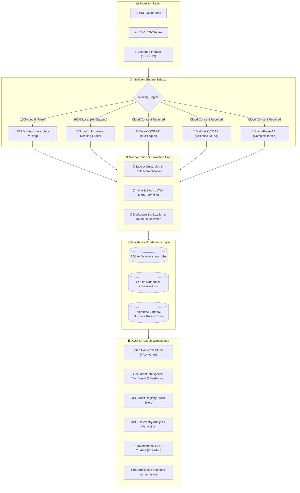

<p align="center">
  <a href="https://github.com/Adarsh-Singh-Chauhan/DOCFORGE">
    
  </a>
</p>

<p align="center">
  
</p>

<p align="center">
  <a href="https://github.com/Adarsh-Singh-Chauhan/DOCFORGE/stargazers"></a>
  <a href="https://github.com/Adarsh-Singh-Chauhan/DOCFORGE/network/members"></a>
  <a href="https://github.com/Adarsh-Singh-Chauhan/DOCFORGE/blob/main/LICENSE"></a>
  <a href="https://vercel.com"></a>
  <a href="#-privacy--air-gapped-security"></a>
</p>

<p align="center">
  
  
  
  
  
  
</p>

---

## 📑 Table of Contents

- [🚨 The Problem Statement](#-the-problem-statement)
- [💡 The DOCFORGE Solution](#-the-docforge-solution)
- [✨ Key Capabilities](#-key-capabilities)
- [🚀 Architecture Diagram](#-architecture-diagram)
- [🖥️ Workspaces & Interfaces](#️-workspaces--interfaces)
  - [1. Batch Converter (Default Route: `#/converter`)](#1-batch-converter-default-route-converter)
  - [2. Mission Control Dashboard (`#/dashboard`)](#2-mission-control-dashboard-dashboard)
  - [3. OCR Document History (`#/ocr-history`)](#3-ocr-document-history-ocr-history)
  - [4. API & Engine Analytics (`#/analytics`)](#4-api--engine-analytics-analytics)
  - [5. Chat History & RAG Studio (`#/chat-history` / `#/chatbot`)](#5-chat-history--rag-studio-chat-history--chatbot)
- [📊 Multi-Engine Parsing Matrix](#-multi-engine-parsing-matrix)
- [📥 CSV & PDF Import/Export Workflows](#-csv--pdf-importexport-workflows)
- [🔒 Privacy & Air-Gapped Security](#-privacy--air-gapped-security)
- [💻 Getting Started Locally](#-getting-started-locally)
- [🌐 Production Deployment Guide](#-production-deployment-guide)
- [⚙️ Environment Variables](#️-environment-variables)
- [📜 License & Attribution](#-license--attribution)

---

## 🚨 The Problem Statement

In the modern AI and enterprise landscape, over **80% of enterprise knowledge** is trapped inside unstructured formats: complex PDFs, scanned contracts, academic ArXiv papers, SEC 10-K financial filings, and dense data tables.

Developers and organizations face four major hurdles when processing documents for LLMs and RAG:

```
┌────────────────────────────────────────────────────────────────────────────────────────────────┐
│                                    THE DOCUMENT PARSING CRISIS                                 │
├───────────────────────────────┬────────────────────────────────────────────────────────────────┤
│ 1. Scrambled Reading Order    │ Multi-column academic papers, callouts, and margin notes get   │
│                               │ collapsed horizontally by naive OCR, destroying context.       │
├───────────────────────────────┼────────────────────────────────────────────────────────────────┤
│ 2. Table & Formula Obliteration│ Financial statements lose rows/columns; scientific equations   │
│                               │ turn into unreadable character soup without LaTeX syntax.     │
├───────────────────────────────┼────────────────────────────────────────────────────────────────┤
│ 3. Massive Token Bloat        │ Feeding raw text or images into LLMs wastes 70-80% of context  │
│                               │ windows and exponentially increases cloud API inference bills. │
├───────────────────────────────┼────────────────────────────────────────────────────────────────┤
│ 4. Privacy & Compliance Risks │ Sending sensitive contracts, audits, or healthcare records to  │
│                               │ third-party cloud OCR APIs violates strict GDPR/SOC-2 policies.│
└───────────────────────────────┴────────────────────────────────────────────────────────────────┘
```

---

## 💡 The DOCFORGE Solution

**DOCFORGE** is an all-in-one document intelligence platform designed to eliminate these pain points:

- **Intelligent Layout Unwarping**: Recovers true multi-column reading orders, hierarchies, and footnotes.
- **Structure-Preserving Extraction**: Extracts complex financial tables into Markdown format and restores scientific equations into block/inline **LaTeX**.
- **80% Token Reduction**: Produces clean, token-efficient Markdown optimized for vector embedding and LLM prompt windows.
- **100% Air-Gapped Local Privacy**: Local neural engines (**IBM Docling** and **Surya VLM**) run fully offline on CPU/GPU with zero network telemetry.
- **Live Observability & Telemetry**: Built-in SQLite database tracks latency, page throughput, cloud costs, and audit history.

---

## ✨ Key Capabilities

| Feature | DOCFORGE Implementation |
| :--- | :--- |
| **Default Landing** | Immediate launch into **Batch Converter** at root URL `/` |
| **Input Formats** | Single & Multi-Page PDFs, Scanned Invoices (JPG/PNG), Raw CSV/TSV Tables |
| **OCR Engines** | IBM Docling (Local), Surya VLM (Local), Mistral OCR, Mathpix, LlamaParse |
| **Output Format** | GitHub-Flavored Markdown, LaTeX Math (`$$\dots$$`), CSV, JSON |
| **Interactive RAG** | Document-grounded conversational chatbot with page & paragraph citations |
| **Data Persistence** | SQLite database preserving jobs, conversation threads, and telemetry metrics |
| **Telemetry UI** | Circular SVG donut charts, dual-axis activity histograms, latency comparison bars |
| **Design System** | Aaron/Aarambh luxury editorial aesthetic, burnt orange accents (`#e04f16`), Dark/Light modes |

---

## 🚀 Architecture Diagram



---

## 🖥️ Workspaces & Interfaces

### 1. Batch Converter (Default Route: `#/converter`)
- **Primary Studio**: Opening the root URL `/` automatically routes directly to `#/converter`.
- **Drag-and-Drop Batch Processing**: Upload single or multiple PDF documents and CSV datasets simultaneously.
- **CSV Preview & Validation Modal**: Interactive preview showing row count, column count, parsed headers, and data integrity checks before ingestion.
- **Live Transformation Theater**: Real-time visual pipeline showing document ingestion, neural layout unwrapping, table extraction, and final Markdown streaming.
- **Sample CSV Templates**: One-click download of standardized CSV templates directly from `/api/templates/csv`.

### 2. Mission Control Dashboard (`#/dashboard`)
- **Responsive Circular Donut Charts**: Live breakdown of **OCR Job Status** (`126 Total Jobs`, 86% Success, 6% Processing, 8% Failed) and **Engine Usage Distribution** (`5 Engines`: Surya VLM 32%, Docling 28%, Mistral OCR 18%, Mathpix OCR 12%, LlamaParse 10%).
- **Dual-Axis Activity Histograms**: 14-day timeline graphing Pages Processed vs. Total OCR Jobs, alongside RAG Conversations vs. Message Volume.
- **Comparative Latency Gauges**: Instant visual comparison of local processing speeds (Docling `1.9s`, Surya `2.8s`) vs. cloud API response times.
- **Executive KPI Cards**: Total OCR throughput, token savings counter (`312.4k tokens saved`), active RAG sessions, and minimum/maximum duration bounds.

### 3. OCR Document History (`#/ocr-history`)
- **Audit Registry**: Filterable, searchable, and sortable database of all historical conversion jobs.
- **Multi-Factor Filter Bar**: Instant client-side & server-side filtering by search term, processing engine, status (`Completed`, `Processing`, `Failed`), date range, and file format (`PDF`, `CSV`, `Image`).
- **3-Stage Selected Job Inspector**: Interactive drawer illustrating the exact progress pipeline (`Uploaded` → `OCR Processing` → `Markdown Export`) with timestamps, page counts, durations, and output formats.
- **Actions**: One-click Markdown copy, raw file download, failed job retry, and comprehensive CSV export.

### 4. API & Engine Analytics (`#/analytics`)
- **Local vs Cloud Breakdown**: Live tracking of local processing ratio (`57% Local`), total inference requests, and estimated cloud expenditure.
- **Local Engines Section**: Highlights **IBM Docling** and **Surya VLM** with zero-fee badges, GPU/CPU execution badges, and 100% on-premise security.
- **Cloud Providers Section**: Displays configuration status for **Mistral OCR**, **Mathpix**, and **LlamaParse** with masked API secrets (`••••••••3f2a`), visibility toggles, and direct configuration modal triggers.
- **Recent API Activity Stream**: Comprehensive execution audit including target document, engine, processing time, status pill, and exact cost.

### 5. Chat History & RAG Studio (`#/chat-history` / `#/chatbot`)
- **Master-Detail Layout**: Left-pane searchable conversation ledger with document associations, message counts, and engine tags; Right-pane interactive detail timeline.
- **Scientific LaTeX Math Formatting**: Native rendering of equations like:
  $$\text{Attention}(Q, K, V) = \text{softmax}\left(\frac{QK^T}{\sqrt{d_k}}\right)V$$
- **Verifiable Citations**: Source attribution chips linking every assistant response back to the underlying PDF page numbers and paragraph references.
- **Follow-up Dialogue Bar**: Seamless continuation of previous research sessions directly within the archive viewer.

---

## 📊 Multi-Engine Parsing Matrix

| Feature / Engine | IBM Docling | Surya VLM | Mistral OCR | Mathpix OCR | LlamaParse |
| :--- | :---: | :---: | :---: | :---: | :---: |
| **Execution Environment** | **100% Local** | **100% Local** | Cloud API | Cloud API | Cloud API |
| **Air-Gapped Privacy** | ✅ Zero Network | ✅ Zero Network | ⚠️ Cloud Consent | ⚠️ Cloud Consent | ⚠️ Cloud Consent |
| **Per-Page Cost** | **$0.00 (Free)** | **$0.00 (Free)** | ~$0.001 | ~$0.004 | ~$0.003 |
| **Average Latency** | `~1.9s` | `~2.8s` | `~4.2s` | `~2.3s` | `~3.8s` |
| **Tables & Financials** | ⭐⭐⭐⭐⭐ | ⭐⭐⭐⭐ | ⭐⭐⭐⭐ | ⭐⭐⭐ | ⭐⭐⭐⭐⭐ |
| **LaTeX & Math** | ⭐⭐⭐ | ⭐⭐⭐⭐ | ⭐⭐⭐ | ⭐⭐⭐⭐⭐ | ⭐⭐⭐ |
| **Degraded / Scanned Prints** | ⭐⭐⭐⭐ | ⭐⭐⭐⭐⭐ | ⭐⭐⭐⭐⭐ | ⭐⭐⭐⭐ | ⭐⭐⭐⭐ |
| **Structured CSV Support** | ✅ Built-in | ✅ Built-in | N/A | N/A | N/A |

---

## 📥 CSV & PDF Import/Export Workflows

### CSV Ingestion & Markdown Table Conversion
DOCFORGE provides full support for comma-separated (`.csv`) and tab-separated (`.tsv`) files:
1. Drag and drop any spreadsheet into the Batch Converter.
2. The platform automatically detects encoding, validates headers, and checks row boundaries.
3. Previews column structures in an interactive modal.
4. Generates clean, token-efficient Markdown tables:
   ```markdown
   | Metric | Q1 2024 | Q2 2024 | Growth |
   | :--- | :--- | :--- | :--- |
   | Revenue | $90.8B | $85.8B | +5.8% |
   | Net Income | $23.6B | $21.4B | +10.2% |
   ```

### Comprehensive Data Export
- **CSV Audit Export**: Export filtered or complete OCR job records via `/api/ocr/export?format=csv`.
- **Markdown Export**: Download individual conversion results with embedded LaTeX formulas.
- **Conversation Transcripts**: Export complete chat dialogues with source citations.

---

## 🔒 Privacy & Air-Gapped Security

- 🛡️ **Air-Gapped by Default**: All core OCR routines (Docling and Surya) operate strictly on your CPU or GPU without transmitting a single byte outside your firewall.
- 🔐 **Consent-Gated Cloud Providers**: Cloud APIs are never contacted without explicit user consent and pre-configured keys.
- 🔑 **Zero Client-Side Secret Leakage**: API credentials remain securely on the backend in environment variables. Keys are masked in frontend payloads (`••••••••xxxx`) and never logged.
- 🗄️ **Persistent Local Storage**: SQLite databases (`pdqa_api/pdqa.db`) keep historical audits on your private disk.

---

## 💻 Getting Started Locally

### Prerequisites
- **Python**: `3.10` or higher
- **Node.js**: `18.0` or higher
- **Package Managers**: `npm` and `pip`

### 1. Clone the Repository
```bash
git clone https://github.com/Adarsh-Singh-Chauhan/DOCFORGE.git
cd DOCFORGE
```

### 2. Launch Backend API Server (FastAPI)
```bash
# Set up Python virtual environment
python -m venv venv

# Activate virtual environment
# Windows PowerShell:
.\venv\Scripts\Activate.ps1
# macOS / Linux:
# source venv/bin/activate

# Install dependencies
pip install -r requirements.txt

# Run backend server
uvicorn pdqa_api.main:app --host 127.0.0.1 --port 8000 --reload
```
*Backend Swagger Docs will be available at [http://127.0.0.1:8000/docs](http://127.0.0.1:8000/docs).*

### 3. Launch Frontend Web App (React 19 + Vite)
```bash
# In a new terminal window:
cd frontend
npm install
npm run dev
```
*Frontend will launch at [http://localhost:5173](http://localhost:5173) and automatically open the Batch Converter.*

---

## 🌐 Production Deployment Guide

### Deploying Frontend to Vercel (1-Click)
1. Fork or import `Adarsh-Singh-Chauhan/DOCFORGE` on [Vercel](https://vercel.com/new).
2. Configure settings:
   - **Framework Preset**: `Vite`
   - **Root Directory**: `./` (or `frontend`)
   - **Build Command**: `cd frontend && npm install && npm run build`
   - **Output Directory**: `frontend/dist`
3. Click **Deploy**. Vercel will build and host your production frontend with global edge CDN caching.

### Deploying Backend to Render or Railway
1. Create a **New Web Service** pointing to this repository.
2. Select runtime: **Python 3**.
3. Set start command:
   ```bash
   uvicorn pdqa_api.main:app --host 0.0.0.0 --port $PORT
   ```
4. Add your optional API keys under Environment Variables.

---

## ⚙️ Environment Variables

Create a `.env` file in the project root to configure optional cloud engines:

| Variable | Required | Description | Default |
| :--- | :---: | :--- | :--- |
| `DOCFORGE_PORT` | Optional | Backend HTTP server port | `8000` |
| `DOCFORGE_DB_PATH` | Optional | SQLite database location | `pdqa_api/pdqa.db` |
| `MISTRAL_API_KEY` | Optional | Mistral OCR Cloud API key | `""` |
| `MATHPIX_APP_ID` | Optional | Mathpix Application ID | `""` |
| `MATHPIX_APP_KEY` | Optional | Mathpix Application Secret | `""` |
| `LLAMA_CLOUD_API_KEY` | Optional | LlamaParse Cloud API Key | `""` |
| `VITE_GEMINI_API_KEY` | Optional | Google Gemini API key for live RAG synthesis | `""` |

---

## 📜 License & Attribution

Distributed under the **Apache 2.0 License**. See [LICENSE](LICENSE) for details.

Developed with pride by **Ansh-Dubey-05**. Contributions, feature requests, and bug reports are warmly welcome!

<p align="center">
  <a href="#docforge-studio">
    
  </a>
</p>
